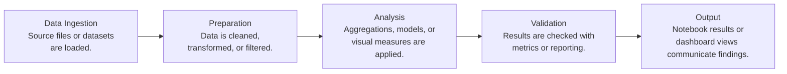

# Data Science Practice

A software project demonstrating a practical implementation and project workflow.

## Overview

This repository is maintained as a learning project or technical archive. It documents an implementation area, a set of practical exercises, or an experiment while preserving a focused and inspectable project structure.

## Key Features

- Data ingestion and cleaning
- Structured analysis or reporting
- Interactive or notebook-based presentation
- Repeatable processing workflow

## Technology Stack

| Area | Technology |
|---|---|
| Library / Framework / Tool | HTML |
| Platform | Jupyter Notebook |
| Library / Framework / Tool | Spreadsheet / CSV data |

## Architecture and Data Flow

| Stage | Responsibility |
|---|---|
| **Data Ingestion** | Source files or datasets are loaded. |
| **Preparation** | Data is cleaned, transformed, or filtered. |
| **Analysis** | Aggregations, models, or visual measures are applied. |
| **Validation** | Results are checked with metrics or reporting. |
| **Output** | Notebook results or dashboard views communicate findings. |

## Repository Structure

- `Excel`
- `hierarichal`
- `KNN`
- `libraries.txt`
- `Machine_Learning`
- `numpy_panda_matplotlib`
- `Python`
- `SQL`
- `Statistics`

## Setup

1. Install Python and Jupyter.
2. Install the libraries used by the notebook.
3. Open the notebook and run cells in order.

## Usage

Run the notebook from the first cell to the final output. Update sample paths or dataset names only when required.

## Configuration

No mandatory repository-specific configuration is documented by the project structure. Environment or runtime options may be defined inside the relevant entry-point file or platform settings.

## Verification

- Run every notebook cell in order and confirm that outputs, metrics, and visualizations complete without errors.
